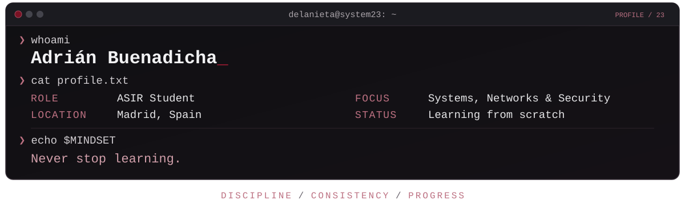

<div align="center">


<br>



</div>

---

### `01. Sobre mí`

```text
¡Hola! Soy estudiante de Administración de Sistemas
Informáticos en Red (ASIR).

Me gusta la informática, las nuevas tecnologías,
los sistemas, las redes y la ciberseguridad.

En este perfil compartiré mis proyectos, prácticas
y todo lo que vaya aprendiendo durante el curso.
```

---

### `02. Tecnologías y herramientas`

<p align="center">

</p>

---

### `03. Actualmente aprendiendo`

- `Administración de sistemas`
- `Redes informáticas`
- `Ciberseguridad`
- `Virtualización`
- `Bases de datos`
- `Programación y automatización`

---

### `04. Mis proyectos`

```text
Próximamente...

Prácticas, proyectos y trabajos realizados
durante mi formación en ASIR.
```

---

<div align="center">


<code>— 23 —</code>

</div>

---

### `05. Mi actividad en GitHub`

<p align="center">

</p>
